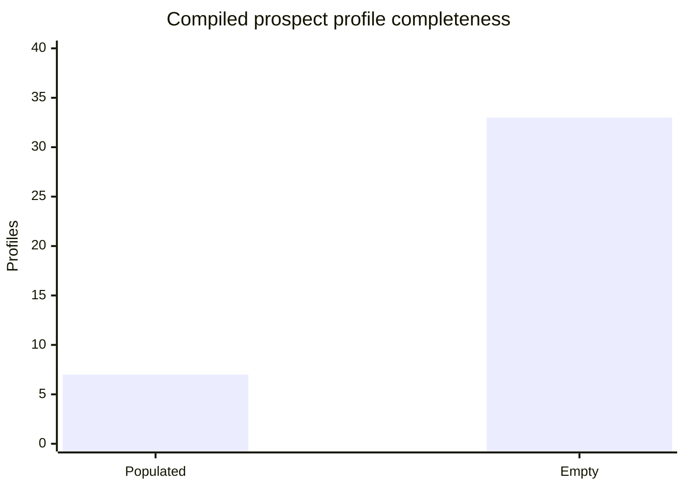

# Dragonflight worker batch010 — research-only prospect profile audit
Date: 2026-10-28. Queue revision 12, assignment `2026-10-28-batch010-dragonflight` overrides home expansion with **40 compiled Prospect profile keys**, Classic through Dragonflight. Exact assigned IDs and per-profile findings are in the companion CSV. Starting production `GameData.lua` blob: `1d47c4a961c5dc5af626e659f7d96d1490d3cf9e`; `StatYieldProfiles.lua` blob: `1d80df8304acaa75a5b507089ef163696381b2ff`. These are read-only references.

## First-pass result
- **40/40 distinct assigned profile keys audited**, 40 exact `gd.prospect[input]` headers and 40 corresponding `gd.tsmRetail.prospect[input]` headers matched. Propose `EXAMINED_INSUFFICIENT` for master review. These are **profile-level keys, NOT 40 newly four-field-scored material outputs**.
- **7 populated compiled profiles with 37 material rows; 33 empty compiled profiles**. All 40 have **607 historical TSM material rows**. Existing `StatYieldProfiles.lua:236–271` populates the 33 empty compiled profiles at load with **372** filtered historical TSM rows. This is an active code-path observation, not a change or a proposed second mapping.
- **All 37 populated material rows** have `chance = 1-exp(-expectedQuantity)` (absolute tolerance <1e-6), `probabilityBasis="POISSON_EVENT_COUNT_PROXY"`, missing conditional min/max, and `provisional=false`. Their `chance` is **not a measured P(at least one)**. Source `samples` on the seven profiles is **ore quantity**, not uniformly actual completed operations. For PTR Osmenite, 40,000 ore correspond to 8,000 reported standard casts; for the Shadowlands aggregates, actual recipe/cast counts are unresolved.
- **39 of 607** TSM source rows fail the necessary `p*positiveMin <= E5 <= p*positiveMax` condition if `matRate` is interpreted as a per-five-ore occurrence probability and `E5=5*amountOfMats` as the same-operation expectation. **33 of 409** rank-filter-selected source rows fail; all 33 are in the 33 empty profiles filled by fallback. This is a source-unit/interpretation contradiction, NOT proof the actual game loot is impossible. Eight affected inputs: `36909,36910,72094,72103,123919,188658,189143,190311`.
- Example Cobalt Ore `36909 -> 36917` (`GameData.lua:887`): p=.235, E5=2.5, historical max=2. `StatYieldProfiles.lua:15–25` would expand the tooltip max to ceil(2.5/.235)=**11** to satisfy the inconsistent assumption. Example Felslate `123919 -> 130178`: p=.01, E5=.01, historical positive min=2; fallback lowers the min to **1**. These are **inferred tooltip ranges**, not observed values.
- Nine rank-specific Dragonflight ore profiles each have 36 TSM rank rows, filtered to 14 first-target-quality rows (324 raw → 126 selected). This prevents simultaneous three-rank valuation but chooses rank 1 as the fallback; no evidence that it matches the character's actual output rank.

## Original-source study synthesis and ancestry
Rechecked https://www.wowhead.com/item=168185/osmenite-ore, which contains two independent original authors with **different conditions**:
- **Snurp:** PTR build 30329, JC 150/175, no tool, 40,000 ore, 8,000 **five-ore standard casts**. Six coloured gems sum exactly 8,000; four common colours 7,087, two rarer colours 913. Rare share among coloured gems = **11.4125%**. Leviathan's Eye = 1,166.
- **close0ne:** live 8.2.5 (before 8.3), JC 175/175, tool yes, 4,000 ore, 200 **twenty-ore mass casts**. Six coloured gems total 800 (common 538, rarer 262). Rare share = **32.75%**. Leviathan's Eye = 130.
- Difference in descriptive rare-colour share = **21.3375 percentage points** (2.86966×). This is **NOT** a patch, skill, tool, or mass-recipe multiplier: all those variables differ. The source's published percentage labels for the mass cohort are percentages of total gem outputs, not measured per-cast P(hit). PTR standard results cannot be automatically applied to live mass or 2026 Retail.
- Two archive records of Snurp's same cohort (`legacy-b003-osmenite-ptr-8000-20261028`, `ww-b008-osmenite-ptr-30329`) are **duplicate representations of one experiment**, not independent replications. The close0ne 200-cast cohort is separate.
- Reused master-reviewed corrected **Tontons BfA** Platinum (`152513`: 322 casts) and Storm Silver (`152579`: 555 casts); do not reuse older reversed-ID records as independent observations. Reused **Osulivan** Shadowlands six ore cohorts as **one author study**, with unknown completed cast denominator, and **Jallfo** Dragonflight 2022 beta six condition cohorts as **one original spreadsheet study**, not six independent experiments.
- **0 newly discovered independent primary study families; 5 original families reused; 3 duplicate source fetches avoided; 1 meaningful source revisit** (Osmenite source context). Shadowlands Wowhead page fetch was anti-bot blocked; relied on preserved original observations, not claimed live page verification.

## Separate numeric mechanics hypothesis
`dragonflight-inspiration-quality-transition` remains **BLOCKED**. The 2022 Jallfo beta cohorts do not record per-cast Inspiration proc flags or zero-inclusive gem-rank outcomes and confound skill/spec/gear. Blizzard's official July 2024 pre-expansion notes explicitly state **Inspiration has been removed**: https://worldofwarcraft.blizzard.com/en-gb/news/24119590 . This is verified qualitative historical nonapplicability, not a numeric 2026 quality-transition coefficient. No new rule, formula, unlock, patch bridge or current Retail coefficient was approved. Hypothesis work contributes **zero** item first-pass keys.

## Evidence confidence and QA
- Four material fields `dropChance`, `yieldMin`, `yieldMax`, `expectedQuantity` are **not newly scored for these 40 profile keys**. Do not invent per-field zero scores or treat 37 Poisson proxies as observed. Existing historical output observations remain in their immutable source files.
- Latest master baseline **1,343/1,737 known keys examined**, 394 awaiting first pass; 1,259 independently scored output records / 5,036 fields: **0 at >=90, 17 at 70–89, 5,019 below70**. This batch awaits master acceptance. Full expansion-by-field chart requires master central ledger aggregation; no made-up breakdown.
- Confidence 0–100 means **strength of evidence, NOT probability a number is correct**. First-pass examined is not all-fields-verified. Current Retail applicability is not established by historical TSM or 2022 samples.
- Deterministic live-GitHub-source static assertions passed for all 40 IDs, profile/TSM source tuples, 37 Poisson proxies, 607 historical rows, 372 fallback rows, 39 raw/33 selected same-unit inconsistencies. No repository Node tests, full external JSON Schema validator or in-game client tests executed. No production Lua/TOC, main, shared ledgers, assignments, registry, or schedules modified.

## Exact next targets for master
1. **P0:** review Cobalt/Titanium `36909/36910`, Kyparite/Black Trillium `72094/72103`, Felslate `123919`, and Dragonflight `188658/189143/190311` conflicting TSM P/E/range assumptions. Do not present inferred `rangeFor` bounds as observed or Poisson probabilities as measured.
2. **P1:** obtain exact same-build standard-vs-mass Osmenite per-cast output IDs, zero-inclusive hits, skill, tool, recipe, refunds and patch; separately sample 2026 Retail for compatibility. Do not pool incompatible 8.2 PTR/live conditions.
3. **P2:** get zero-inclusive Dragonflight ore-rank gem-output observations with actual current skill/spec/gear/Concentration and recipe ID. For *historical* Inspiration coefficient only, obtain pre-removal same-build proc-flagged matched cast logs and independent replication.

### Visual audit

