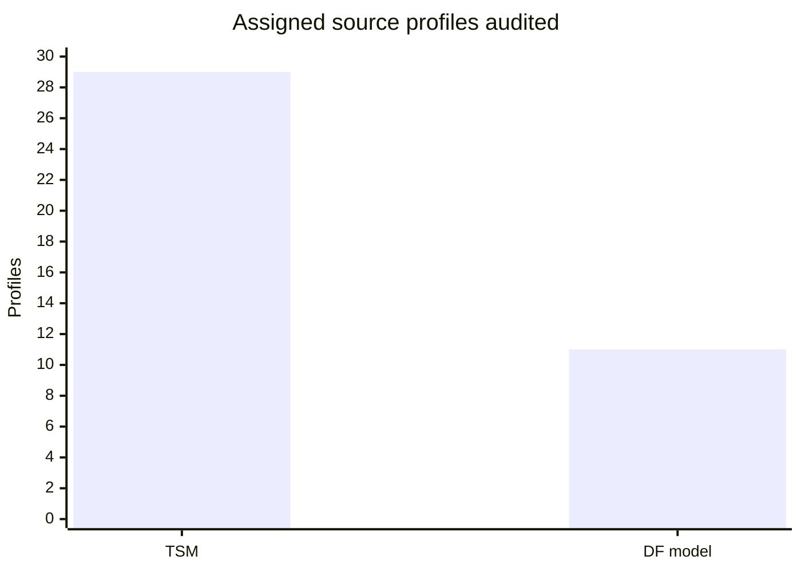

# Dragonflight research Batch011 — 40 exact prospect profile keys
2026-10-28. Master queue revision 13; assignment 2026-10-28-batch011-dragonflight. Research-only; no main/GameData.lua, TOC, production addon, master ledger, assignments or schedules changed. Main GameData blob 1d47c4a961c5dc5af626e659f7d96d1490d3cf9e; queue blob a51ffdfe8edd4a20f914659b8acc14b174df79d1.

## First-pass coverage and source audit
All **40/40 unique assigned keys** were `NEVER_EXAMINED` in the master coverage ledger and have exact GameData source headers: **29 TSM profiles / 556 output rows** and **11 Dragonflight family profiles / 142 family rows**. Propose `EXAMINED_INSUFFICIENT` for independent master acceptance, not 160 newly verified material fields. See companion CSV for every key. Source inventory spans Dragonflight and assigned historical overflow.

**27 of 556 TSM rows** in six profiles (190311, 189143, 188658, 123919, 72103, 72094) fail `p×positiveMin <= E5 <= p×positiveMax` IF `matRate` and `5×amountOfMats` describe the same five-ore operation. These are source-unit/interpretation contradictions, not measured impossible game outcomes; the 27 exact rows are archived without repair. **363 rank-specific TSM rows** include mutually exclusive gem-quality alternatives, never three simultaneous drops. **113 of 142** modeled Dragonflight family rows are marked `anchor="transfer"` (only 13 direct, 16 unanchored), often transferring R3 Serevite context. No verified minimum-eligible unskilled back-normalization exists. `gd.prospect[194545]` and `gd.prospect[192880]` are dynamically built from Dragonflight profiles at the end of GameData, even though they have no literal `gd.prospect[id]` header.

## High-priority field triage
**Prismatic Ore 194545 → Illimited Diamond rank family (192869/192870/192871):** Reused ONE original historical superbondez study, 400 ore / **80 actual five-ore casts**; diamonds R1=1, R2=4, R3=1. Unconditional family E = **6/80=0.075 units/cast**; rank E = 0.0125/0.05/0.0125. P(at least one), positive min/max, exact skill/gear/patch and 2026 Retail applicability are **unknown**. TSM family E=.07 is descriptively close (7.14% lower), but TSM source ancestry is unknown; no independent corroboration or confidence promotion. Adding all three TSM rank alternatives yields .21, **2.8×** the original all-rank mean and is invalid. The source's Eternity Amber R1/R2 text is malformed; do not infer values. Original observation: `midnight-b010-df-superbondez-prismatic-80casts`, URL https://www.wowhead.com/item=194545/prismatic-ore .

A 2023 original Blizzard bug report of Prismatic being greyed out was self-resolved: the user had fewer than five ore (https://us.forums.blizzard.com/en/wow/t/unable-to-prospect-prismatic-ore/1480672). Warcraft Wiki also documents prospectability (https://warcraft.wiki.gg/wiki/Prismatic_Ore). These historical facts do **not** prove 2026 recipe eligibility; current build and learned recipe must be probed in game. A July 2024 original two-cast Concentration report (https://us.forums.blizzard.com/en/wow/t/concentration-and-prospecting/1901868) describes rank-3 prospects and inconsistent 0/55 Concentration charges but no output IDs/hit counts or matched controls; it cannot quantify Inspiration.

**Cobalt 36909 → Bloodstone 36917:** TSM `matRate=0.235`, `E5=2.5`, positive max=2. Under same-operation interpretation E5 cannot exceed `0.470`, so 2.5 is inconsistent. Historical Warcraft Wiki documents 1–2 Bloodstones at approximately 24% (https://warcraft.wiki.gg/wiki/Cobalt_Ore). Without original cohort denominators or current Retail samples, do not invent a corrected E or tooltip max=11.

## Study synthesis and numeric mechanics
Reused **2 existing original primary study families** (superbondez and the Jallfo six-cohort 2022 beta spreadsheet), avoided 2 duplicate primary fetches, examined 2 new low-resolution forum leads and 1 purposeful Prismatic eligibility revisit. **0 new independently measured cohorts** and **0 approved current-Retail material corrections**. Jallfo's six conditions are one original study; exact actual cast counts, Inspiration flags, zero-inclusive rank histograms and verified source item IDs are missing.

The assigned **dragonflight-inspiration-quality-transition** remains **BLOCKED**. Blizzard removed Inspiration in 2024 (https://worldofwarcraft.blizzard.com/en-gb/news/24119590). Historical 2022 skill/spec cohorts do not isolate Inspiration; post-removal Concentration is a different mechanic. Numeric candidate stays `applyPolicy=BLOCKED`, `numericTransformValidated=false`, zero coefficients approved. Next experiment: matched pre-removal exact recipe/ore rank/skill/spec/gear with Inspiration proc flag and per-cast rank outputs including zeros; for 2026 Retail, test actual Concentration/skill thresholds independently. Never multiply unconditional E by P or infer yields from range midpoint.

## Confidence and master progress
Assigned profile keys do not add four scored output fields each. Field confidence deltas for P, min, max and E: **0**. Master-accepted baseline **1493/1737** first-pass keys; 244 remain; 5236 material fields scored: 5187 below70, 49 70–89, **0 ≥90**. This batch is pending master review. Evidence confidence 0–100 is **strength of support**, not the probability an estimate is correct. Historical evidence is not a verified 2026 Retail baseline.

## QA and next exact targets
Static checks passed: 40 distinct keys, 40 NEVER_EXAMINED ledger rows, 40 source headers, 698 material/family rows, 27 contradictions flagged, 80-cast original arithmetic verified. Full Node, external schema and in-game tests **not run**. No reward points self-awarded. Exact follow-up: 2026 194545 prospect eligibility and rank-specific 192869/192870/192871 cast logs; 36909→36917 zero-inclusive 200+ cast histogram; 192880 self-return versus Resourcefulness refunds; the six anomaly-profile IDs in validation; next master-assigned disjoint queue only.

Machine-readable chart data and source-review events are in companion files; expansion-specific confidence cannot be inferred from these profile-only keys.
