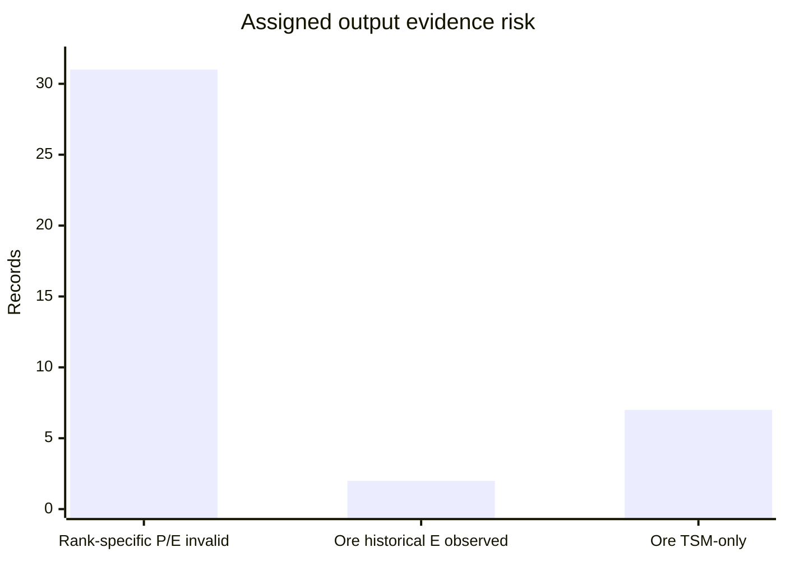

# Dragonflight Batch012 — material-first output/rank review
2026-10-28 12:31 PDT. Queue revision **14**, assignment `2026-10-28-batch012-dragonflight`. Queue blob `3e957fb2fdb8bf8fdc2fb4c5f928ba3b28d690f6`; source ledger `3e2bb784dc832d90584eebd8620148caf2133fbd`; GameData `1d47c4a961c5dc5af626e659f7d96d1490d3cf9e`. Research-only.

## Result
**40/40 exact assigned output keys audited**: 31 milling pigment-rank rows and nine ore→Crumbled Stone (192880) rows. **Zero newly discovered input/output IDs in this assigned set.** Two previously archived independent original experiments provide direct historical unconditional expected quantities for assigned Crumbled Stone outputs; no new 2026 measurements.

## P0 — 31 quality-rank records risk major valuation inflation
Ten full rank triplets each assign historical TSM `P=1, E=3.5, positive min=2, max=5` to **each** R1/R2/R3 pigment. Their simultaneous sum is **10.5 pigment and probability sum 3 per five-herb cast**, versus the archived 2022-10-22 beta source's **2–5 TOTAL pigment per cast**, one quality rank selected by skill/proc (https://www.wowhead.com/news/crafting-work-orders-are-here-wowhead-economy-weekly-wrap-up-251-329620). The 31st assigned rank is Hochenblume R3 in a partially assigned triplet. TSM's 3.5 is a **family-level historical reference, not independently measured E=3.5 for each rank**. Propose master quarantine **31 rank-specific P and 31 rank-specific E cells** as UNKNOWN while preserving all legitimate output IDs and advisory family mean. Historical conditional 2–5 bounds may remain provisional, not measured per rank. Do not infer current 2026 rank thresholds from removed 2022 Inspiration.

Independent original context checks (reused, not new cohorts):
- R2 Hochenblume `191461→198423`: 9,000 R2 herbs yielded **1,418 R3** and 6,050 R2 pigments, skill233, Inspiration18.3%, Resourcefulness35% (https://www.reddit.com/r/woweconomy/comments/10me1e7). **0.78778 R3 per nominal five-herb equivalent**, NOT per actual cast because saved herbs change the denominator. Historical TSM rank-specific 3.5 is **4.44×** this gross equivalent, a serious potential R3 price/EV distortion.
- R2 Saxifrage `191465→198420`: Aary reports 100 R2 herbs yielding **16 gold** and 64 grey pigments with max ink tree/gear (https://www.wowhead.com/item=198418/blazing-pigment). **0.8 R3 per nominal five-herb equivalent**, NOT actual-cast E. TSM 3.5 is **4.375×** that descriptive equivalent. Source lacks cast count and exact skill. The 2023 Method guide corroborates herb→pigment families, not yields: https://www.method.gg/guides/what-dragonflight-herbs-do-you-need-to-mill-to-get-each-pigment .

## P1 — original Crumbled Stone E, with actual casts
| Assigned key | Original cohort | Actual casts | Crumbled Stone units | E/cast | Historical TSM E |
|---|---|---:|---:|---:|---:|
| `190396→192880` R2 Serevite | Dec 12, 2022; skill171, Inspiration18%, Resourcefulness3% | 1000 | 1427 | **1.427** | 1.424 |
| `190394→192880` R3 Serevite | Jan 10, 2023; skill283, Inspiration15%, Resourcefulness22% | 8000 | 11472 | **1.434** | 1.424 |

Sources: https://www.reddit.com/r/woweconomy/comments/zkay8v and https://www.reddit.com/r/woweconomy/comments/108782r. Differences from TSM are **+0.21%** and **+0.70%** respectively. These independent cohorts have **different ranks/skills/patches**, so do not pool into an unskilled baseline. Ore saved (36 and 2650) is Resourcefulness **input savings**, not extra output. Neither experiment reports P(at least one), positive min/max or zero-inclusive per-cast histogram. Keep TSM P=.57 and min/max=[1,3] labelled *provisional proxies*, not measured; other seven assigned ore keys have only historical TSM E=1.424. No current Retail rate promoted.

## P0 adjacent existing quarantine — no self-claim
Crumbled Stone `192880` is itself prospectable and historical players report receiving some `192880` while prospecting it (https://www.wowhead.com/item=192880/crumbled-stone). Master already quarantined `192880→192880` as self-return/refund ambiguity. A self-output must not automatically be discarded as a refund, but no new stable key or first-pass credit is claimed. Master should explicitly assign this if needed and distinguish actual output from refunds using per-cast logs.

## Source lineage, decisions and blockers
Reused original 1000-cast and 8000-cast Serevite studies, Hochenblume and Saxifrage observations, and a **derivative** beta report (original Reddit deleted). Four duplicate primary fetches avoided. No newly independent studies, no novel current-Retail measurement, no confirmed AH price decision flip. The 4.4× R3 discrepancy makes rank-specific valuation a P0/P2 priority; without live prices, exact 2026 character stats and skill, an Auction-versus-Mill flip cannot be asserted.

Field audit companion JSONL independently records four fields, source, 0–100 confidence, original denominator, rank, condition and unknowns for every assigned key. Two historical E values are corroborated, **62 rank-specific P/E cells flagged** for master review, and **zero master-accepted confidence promotions**. Evidence confidence is strength of support, not probability of correctness.

## QA and next exact targets
40 unique assigned keys, 40 GameData output line identities, 10 complete triplets, arithmetic of both original actual-cast means, rank exclusivity and Resourcefulness separation checked. Full Node, external schema, Lua and WoW client tests NOT run. No production, queue, master ledger, registry or schedule writes.

Next exact IDs: `191461→198423`, `191465→198420` (actual cast and rank histograms), `191462→198421/198422/198423` (minimum-eligible rank anchor), `190396→192880` and `190394→192880` (hit counts, 2026 patch). Wait for master reassignment before claiming any other worker's keys.

