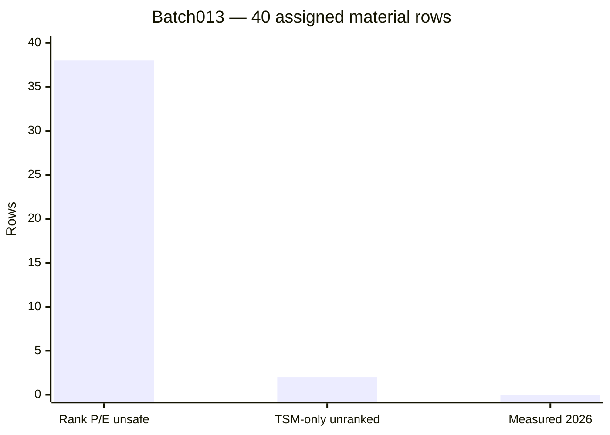

# Dragonflight Batch013 — 40 exact material records, rank-exclusive valuation audit
2026-10-28 13:28 PDT · research/processing-confidence only · queue revision 15 · 2026-10-28-batch013-dragonflight

## Findings for master
- **40/40 exact assigned output keys** checked against `GameData.lua` pinned blob `1d47c4a961c5dc5af626e659f7d96d1490d3cf9e` and canonical primary ledger blob `3e2bb784dc832d90584eebd8620148caf2133fbd`. 14 Prismatic Leaper fish-milling rows (`200061`) and 26 rank-2 Draconium Ore prospect rows (`188658`). Zero newly discovered mapping IDs, zero new current-Retail cast measurements.
- **P0 rank duplication:** all **38 quality-ranked assigned outputs** (12 fish pigments, 26 ore gems) repeat a historical TSM family P and E across rank alternatives without independent rank-specific measurement. Recommend master quarantine **38 dropChance and 38 expectedQuantity numeric cells (76 total)**, retaining IDs, source proxies, provisional positive ranges, and original lineage. The 12 fish rank rows form four complete triplets; 26 ore rows form eight triplets plus one partial rank pair (third `192865` is unassigned, not claimed). The master accepted this exact precaution for 31 other DF pigment rows in batch012.
- **P0 input-rank identity:** `200061` Prismatic Leaper is an unranked fish, but `GameData.lua` sets `sourceQuality=1` on all 12 fish pigment rows. Proposed correction: inputQualityRank=null; preserve outputQualityRank 1/2/3. The two assigned Rousing Fire `190320` and Rousing Frost `190328` outputs are unranked TSM-only provisional candidates, not newly independently observed fish-milling drops. `190322` is a related **unassigned** output and was not reviewed or claimed.
- **TSM unit arithmetic matters:** `amountOfMats` is imported per one input; primary ledger multiplies by five for a five-item operation. For fish pigment, P=.2462, E=5×.1723=.8615, positive [2,5], so .4924 ≤ .8615 ≤ 1.231. All 40 assigned P/E/range tuples pass necessary bounds individually; rank duplication remains a separate failure. Do not double-multiply E by P.
- **Fish family valuation example:** 12 duplicated rank E values sum to **10.338 pigments per cast**; four distinct pigment family references sum to **3.446**. Reused original Primer report: 15 fish milled in **3 actual casts**, 3 Blazing R2 (`198419`), 5 Flourishing R2 (`198416`), 2 Flourishing R3 (`198417`), or **3.333333 pigments per cast total**. Family-level TSM and the tiny historical sample are descriptively close, but original source ancestry and exact skill/build unknown; not independent validation or a 2026 baseline. The three contextual E values are 1, 1.666667, .666667 respectively, P and positive bounds unknown.
- **Draconium illustration:** naive sum of 26 rank-specific TSM E values is **5.5905** per cast versus **1.9100** if each of nine represented gem families is counted once (one family only has two assigned ranks). This is a potential **2.93×** rank-overvaluation, not a measured current game output. Source has 5 ore/cast, Q2 input `188658`; Jallfo 2022 beta sheet and Bugy 2×2000-ore reports are not exact matched Q2 current Retail per-rank histograms.
- **P2 decision risk:** output quality prices can differ sharply; tripling rank E may flip Auction/Prospect or Auction/Mill recommendation. No live 2026 input/output prices and character eligibility matched, so no actual decision flip asserted. Unranked fish Resourcefulness claims in 2023 Reddit thread lack controlled counts and are not promoted.

## Independent source lineage and source-memory learning
1. Reused original `df-b008-fish-3-casts-wowhead-comment-primer` (one 3-cast cohort), https://www.wowhead.com/item=200061/prismatic-leaper; **3 historical context-specific E fields**, not 3 new studies.
2. Reused `research/evidence/observations/2026-10-28-draconium-bugy-2x2000ore-unassigned-quality.json`, https://www.wowhead.com/spell=374627/dragon-isles-prospecting. Input rank was not identified: do NOT force it to `188658`.
3. Historical TSM-like source: pinned `GameData.lua` and `research/ledger/processing-output-fields.csv`; unknown original TSM cohort/denominator/skill.
4. New qualitative-only forum thread https://www.reddit.com/r/woweconomy/comments/100anp2 confirms historical five-fish milling; no measured output dataset. Fish Resourcefulness anecdote remains unverified. Two repeat primary fetches avoided using source memory.

## Adjacent P0 compiler regression to master (outside assigned stable keys)
In `research/tools/compile_itemdb.js`, `raw` serialization appends `eligibilityStatus` and `baselineStatus` at indices 25/26 (Lua 1-based), but decoded `conditions` hardcodes `eligibilityStatus="UNVERIFIED_CURRENT_RETAIL"` and `baselineStatus="MINIMUM_RECIPE_ELIGIBLE_UNSKILLED_NOT_ESTABLISHED"` instead of using `x[25]`/`x[26]`. This **drops previously approved seven Midnight diamond specialization gates from the emitted Lua conditions** even though intermediate research records are gated. Master should repair and regression-test before runtime integration. Worker did not touch compiler or Midnight files.

## QA / next exact targets
All 40 source identities and 40 per-row arithmetic inequalities passed; 12 fish input-rank metadata errors; 76 proposed rank P/E quarantines. Master owns acceptance, compiler, central ledgers, QA scores and next queue. **Exact next targets within this batch:** `200061→198416/198417/198419` zero-inclusive cast histograms and skill context; `200061→190320/190328` verify actual output eligibility; `188658→192837/192838/192839`, `188658→192849/192850/192851`, `188658→192862/192863` obtain Q2 ore matched rank distributions and cast denominators. The related `188658→192865` requires explicit master assignment.

No production Lua/TOC, main, master ledgers, assignments, source-memory cache, schedules, or compiler changed. Node/Lua/WoW client tests not executed. Evidence confidence is 0–100 strength of support, not statistical probability of correctness.

