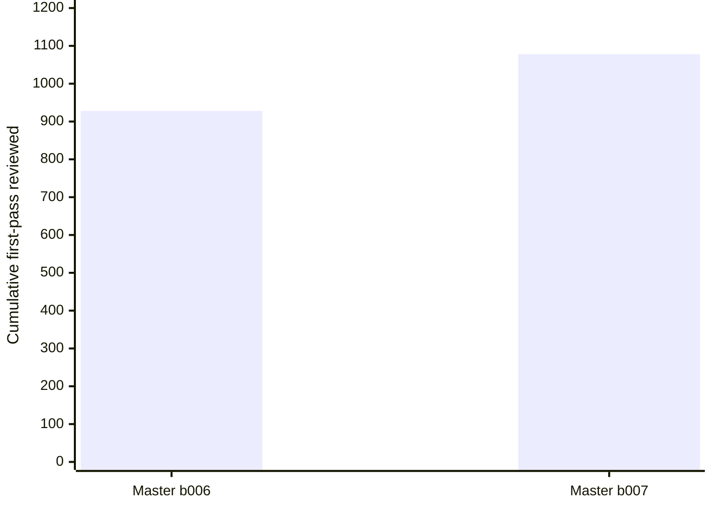

# Loot Liquidator Legacy — Batch 008 original-source synthesis (2026-10-28-0837-legacy-batch008)
**Research-only branch:** `research/processing-confidence` · **Queue:** rev10 / `2026-10-28-batch008-legacy` · **Starting branch head:** `4684ab56b69c8bc1ce546e6eff83ddc835fe5587` · **GameData.lua source SHA:** `1d47c4a961c5dc5af626e659f7d96d1490d3cf9e`. No production changes, central-ledger edits or queue edits.

## Exact assigned first-pass coverage
- **40/40** disjoint assigned keys audited, **27 Shadowlands prospecting** and **13 Classic/Outland milling**; all were `NEVER_EXAMINED` in live master ledger. No extra first-pass records claimed.
- **40** exact source-line/output/header matches, **40** ledger-status checks and **40** necessary TSM arithmetic checks passed. The latter uses a **hypothetical** `E5=5*amountOfMats`, and `matRate*min <= E5 <= matRate*max`; it does not prove TSM unit definitions, probability, actual min/max or current patch.
- Proposed four-field confidence per row: `P=35, yieldMin=35, yieldMax=35, E=40` for 20 source-only TSM records; `E=60` (historical *input-normalized corroboration only*) for 20 Osulivan-matched records. Weakest-field record confidence **35** for all 40. No field >=70, no full-record >=90, no current-Retail correction.
- These **40** are submitted for master first-pass acceptance, **not** booked as master-accepted. Live master snapshot before acceptance: **1078/1737** examined, **659** never, **0** fully >=90; if independently accepted and no other changes, potential first-pass becomes 1118/1737, but **do not count that as current**.

## Reused original Osulivan Shadowlands source: 20 exact assigned output matches
**Primary:** https://www.wowhead.com/spell=311949/mass-prospect-solenium (Osulivan's one six-ore table). Source says quantities **per ore prospected**. Reused existing observations `research/evidence/observations/2026-10-28-legacy-batch003-osmenite-shadowlands-felslate-original-cohorts.jsonl`, one studyID, not six independent experiments. Source page's **mass Solenium recipe consumes 20 ore**. Earlier archive sets `batchInputsPerOperation=5` for all six rows; the later batch008 archive sets 20. Neither is proof of which recipe the author actually used on each ore. **Do not treat 5-ore equivalents as observed casts.** This is a concrete normalization/provenance blocker to reconcile with master QA.

For 20 assigned output pairs, source totals per 500 or 1000 ore allow **descriptive** `5*totalUnits/reportedOre`, not an actual cast mean. Against conditional historical TSM `5*amountOfMats`: 7 above, 13 below; mean absolute discrepancy **0.0415** units per five-ore equivalent. No operation-level variance or valid CI. Key differences:
- `171833→173108` L1156: historical Osulivan **0.8200** vs TSM proxy **1.0000** (difference **-0.1800**); source `legacy-b003-osulivan-171833-20261028`.
- `171829→173173` L1135: historical Osulivan **0.2200** vs TSM proxy **0.3225** (difference **-0.1025**); source `legacy-b003-osulivan-171829-20261028`.
- `171833→173109` L1157: historical Osulivan **1.0900** vs TSM proxy **1.0000** (difference **+0.0900**); source `legacy-b003-osulivan-171833-20261028`.
- `171830→173110` L1140: historical Osulivan **0.4350** vs TSM proxy **0.5000** (difference **-0.0650**); source `legacy-b003-osulivan-171830-20261028`.
- `171833→173173` L1162: historical Osulivan **0.3200** vs TSM proxy **0.3825** (difference **-0.0625**); source `legacy-b003-osulivan-171833-20261028`.
- `171832→173110` L1152: historical Osulivan **0.5400** vs TSM proxy **0.5000** (difference **+0.0400**); source `legacy-b003-osulivan-171832-20261028`.
All Osulivan data are Shadowlands-era, recipe/skill/build/hit counts unknown, not directly poolable with current Retail or another study. P(at least one) and observed positive conditional integer min/max remain **unknown** even where source totals exist. ExpectedQuantity candidates remain **historical ore-normalized only**; never double-multiply by P.

## Two new original source leads (not two verified numeric studies)
1. **Progenium PTR, 2021-12-03:** https://www.reddit.com/r/woweconomy/comments/r80lkp — original author reports 10,000 ore and approximately 0.7% *per essence*, plus a 10,000-ore Elethium PTR comparison (3.5% vs reported 2.7% live). No mapped output totals, actual casts or patch bridge. This does **not** prove 2026 Retail Progenium `187700` output-specific E. Conditional TSM 0.018/ore vs stated 0.007/ore illustrates a possible source/patch discrepancy only.
2. **Felweed historical pigment totals:** https://www.wowhead.com/item=43108/ebon-pigment — original player reports **94 Nether Pigment (39342)** and **4 Ebon Pigment (43108)** from Felweed (22785) after 3.0.2. No herb count or actual casts; zero-inclusive E and P unavailable. One new schema-shaped source observation preserved. A comment about getting 3 Ebon in one cast is not tied to Felweed specifically and cannot establish its output max.

**Reused source cohorts:** Osulivan one six-ore study; prior Felslate worksheet and archived 113 mass-cast report for separate mechanics. **Duplicate fetches avoided:** Felslate worksheet and 113 mass source; translated Wowhead copies of Osulivan's same table not counted independently. **Purposeful revisit:** Osulivan spell page to resolve 20-ore recipe versus older 5-ore archive assumption. Source review events are worker-owned and status PARTIAL, not self-marked FULLY_ANALYZED.

## Separate numeric hypothesis: `legacy-felslate-standard-mass-compare`
Reused https://www.scribd.com/document/359130779/Full-Legion-Worksheet: 10,000 Felslate ore per historical arm, standard 5 ore vs mass 20 ore. Rare gem totals standard **341**, mass **334**; uncommon **2063** vs **2070**. Five-ore equivalents are descriptive, not actual completed operations. The separate 113-mass-cast archive (https://www.wowhead.com/spell=225904/mass-prospect-felslate) lacks reliable item-ID mapping, matched build, same-character controls and standard comparison. **EMPIRICAL_ESTIMATE / BLOCKED; no approved coefficient, no current patch transform.** Next experiment: >=200 **actual** casts per recipe on same build/character, exact 123919 input consumption and saved ore, output IDs, positive counts and zeros, matched skill/gear; independent replication.

## QA, charts and next experiments
- Static QA: 120 checks (source-line/input, master ledger, necessary arithmetic), 40 unique keys, 20 exact historical input/output comparisons. No external JSON Schema engine, repository Node suite or live WoW tests run. The Felweed observation is structurally schema-shaped; full external schema validation remains outstanding.
- **Master confidence by expansion:** unavailable without master-owned per-expansion field ledger; no guessed bars. **This batch field bands:** 40/40 below70 for each of four fields; 0 at >=90. Evidence confidence is *strength of support*, not probability of accuracy.

- **Highest gold-decision value tests:** same-build 187700 Progenium prospecting (rare essences affect AH-vs-vendor) with full output histograms; paired 171829 Solenium essence 173173 for observed 0.22 vs TSM proxy 0.3225/5 ore; 22785 Felweed milling 43108 denominator and per-cast hits. Quantify ore and time cost before running; no unsupported gold savings claim.
- **Master review requests:** accept exact 40 first-pass keys only after independent QA; reconcile Osulivan batch mismatch and translated duplicate lineage; investigate Progenium PTR versus later Retail; review new Felweed source; do not promote numerical mechanic or current output mean.

**Production and schedules:** untouched. One future authoritative `itemdb.lua` only after separate approved migration; no second shipped mapping.
