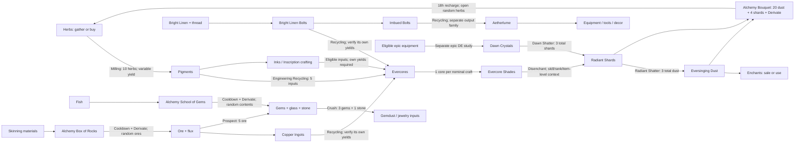

# Grizzly Hills profession chains and TSM cost screen

Research only, November 7, 2026. No addon runtime, approved baseline, player
settings, auction listings, purchases or other applications were changed.
The purpose is to choose inexpensive, useful measurements and expose better
conversion decisions in Loot Liquidator. A conversion chain is not necessarily
a profitable or self-sustaining loop.

## Price evidence and scope

`price-snapshot.json` freezes 147 relevant item/variant entries from the owner's
local TSM AppHelper feed. The original feed SHA256 is
`da524cf53b845b1cc4d9d84436046b2e1fc4b293bfb99aceb1c325b04e33ba21`.
Commodity minimums and market values are stamped **November 7, 17:23:30 PST**;
Grizzly Hills equipment minimums are **16:22:40 PST**. Regional sale statistics
are from **00:47:36 PST**. These are snapshots, not executable auction depth or
guaranteed sales. Item names come from the older public TSM commodity CSV;
that CSV's prices are not mixed with the newer local prices.

The local decoder follows installed TSM code: base-32 fields, positive-value
checks/zero-to-nil, last duplicate row wins and per-source item-level/base
lookup. Source references are `LibTSMService/Source/AuctionDB/AuctionDB.lua`,
`LibTSMService/Source/AppHelper/AppHelper.lua` and
`LibTSMApp/Source/Config/AuctionDBConfig.lua`. Exact variant listings stay
distinct: the owner's Shade i165 has a **9.00g** quote; the base item's 8.99g
quote comes from i168. A source falling back to the base item does not prove
that the desired variant is actually for sale. Exact-variant sale statistics
can be unavailable even where base-item statistics exist.

TSM documents [region-wide commodities and realm equipment data](https://tradeskillmaster.com/public-data)
and [price-source meanings](https://support.tradeskillmaster.com/custom-strings/which-price-sources-can-i-use-and-what-do-they-mean).
DBMarket and sale averages are not interchangeable with the current minimum.
Regional sale rate is not an independent sale probability for each listing.

## Extended chain

Each intermediate can also be bought or sold. Charge the AH fee once at the
chosen terminal sale, not at every internal arrow, and compare continuing with
selling that intermediate. Gathered/owned materials have opportunity cost.

The actual closing edge is [Bouquet of Herbs, spell 1230892](https://www.wowhead.com/spell=1230892/bouquet-of-herbs):
20 dust + 4 shards + 1 **BoP Stabilized Derivate** produce one openable bouquet,
with an 18-hour recharge/two-charge gate. Its herb quantities and quality need
measurement. Current R1 tradable inputs cost **24g before Derivate**. The
BoP reagent is not free simply because it has no AH price. Do not confuse this
with discovery spell 1248784, which has different research/unlock costs.
This closes a material graph, not a proven infinite-profit cycle.

The epic branch also does not establish blue-to-purple transfer of probabilities.
An eligible purple input needs its own quantity/quality observations. A cheap
repeatable Engineering purple craft was not established: [Aetherlume Bands](https://www.wowhead.com/spell=1229875/aetherlume-bands)
has Spark-category, BoP, additional-material and specialization restrictions.
Do not present Aetherlume -> cheap purple gear -> crystals as an unrestricted shuffle.

## Rank-aware input costs

| Item | R1 minimum | R2 minimum |
|---|---:|---:|
| Bright Linen | 1.45g | 2.51g |
| Bright Linen Bolt | 1.50g | 2.39g |
| Imbued Bright Linen Bolt | 2.70g | 2.96g |
| Powder Pigment | 2.88g | **2.80g** |
| Evercore | 2.50g | 4.70g |
| Radiant Shard | 2.00g | 2.69g |
| Eversinging Dust | 0.80g | 1.54g |

[Bright Linen Bolt 1228939](https://www.wowhead.com/spell=1228939/bright-linen-bolt)
nominally uses one linen + four Silverleaf Thread. At the AH thread quote of
0.15g, that is **2.05g using R1 linen** or **3.11g using R2 linen**, before
refunds/Multicraft and any cheaper vendor quote. Buying the finished bolt is
cheaper at either rank in this snapshot. Higher-rank input does not by itself
certify the output rank; use the native operation's quality preview.

Rank is not a price ordering: R2 Powder is cheaper than R1 here. Compare every
acceptable rank, preserving its actual item ID and input/output quality in the
research. Do not pool unlike contexts merely because the item names match.

The owner's saved client list establishes **88 eligible Recycling item IDs**;
all 88 have snapshot quotes. `recycling-inputs-ranked.csv` ranks all of them.
The cheapest five-input batches are plain R1 bolts **7.50g**, R1 Argentleaf
Pigment **10.35g**, plain R2 bolts **11.95g**, imbued R1 bolts **13.50g**,
R2 Powder **14.00g**, and R1 Powder **14.40g**. Eligibility is client evidence;
it does not establish equal yields or the Evercore/Aetherlume output family.
Original player mappings support plain bolts -> Evercore and imbued bolts ->
Aetherlume, but both still need their own native receipt sample. Source:
[original player mapping discussion](https://us.forums.blizzard.com/en/wow/t/engineer-recycling-only-gives-evercores/2259599).

## Economics and inexpensive research targets

The owner's measured references remain scoped: Engineering 40/bonus0/no-spec
R1 Powder produced **388 R1 Evercores from 200 casts/1,000 pigment**. The rare
i165 Shade reference at Enchanting 82/no-spec has **405 casts: 368 R1 / 37 R2
shards**. Neither is a universal profession, rarity, input or skill curve.

`analyze.py` reproduces twenty cost scenarios in `cost-analysis.json` and
`cost-comparisons.csv`. Seller-fee scenarios use 5%, with no deposits, time,
price-depth, bonus procs or free Concentration assumptions.

| Route | Current input budget | Finding / next measurement |
|---|---:|---|
| 5 R1 Powder -> measured Evercores | 14.40g/cast | Output is only 4.85g gross, 4.6075g after fee. Recycling for data is different from selecting a production route. |
| Buy R1 Evercore -> Shade -> measured shard mix | 2.50g/Shade | About 1.96g after sale fee at the 82-skill reference, before other bonuses. Direct cores cheaply supply further controlled DE tests. |
| Core -> sell matching i165 Shade | 2.50g nominal material | 9g listing yields a theoretical 6.05g margin after fee, before deposit. Low/unknown exact-variant liquidity prevents treating this as quick guaranteed gold. |
| 10 R1 Tranquility Bloom -> pigment | 20.10g/cast | Need at least 7.35 R1-pigment-equivalent output at current minimum prices after fee. At regional sale average, need about 15.15. Measure quantity/quality and cooutputs. |
| 5 plain R1 bolts -> Evercore-family test | 7.50g/cast | Cheapest native-eligible input. First verify outputs with a small pilot; do not substitute pigment's 1.94 yield. |
| 5 imbued R1 bolts -> Aetherlume-family test | 13.50g/cast | Separate output-family measurement; Aetherlume R1 quote4.79g. Compare buying output directly too. |
| R1 Radiant Shard -> 3 R1 dust | 2.00g/cast | 2.40g gross, 2.28g after fee: **0.28g** before deposits/time. Cheap fixed-output/Resourcefulness recorder check. |
| 2 plain bolts + 2 thread -> Courtly Wrists -> DE | 3.30g/craft | Tailoring alternative to Shades. Verify rarity/item level and its own DE coverage. Do not borrow Shade outcomes without a matched-context check. |
| 5 R1 copper ore -> prospecting outputs | 27.25g/cast | Measure the joint gems/glass/stone vector. Output distributions are unknown for the owner's profile. |
| 3 cheapest R1 gems + 1 R1 stone -> Gemdust | 110.90g/cast | Much more expensive RNG study; output amount/rank unknown. Not a first cheap test. |
| Cheap potion -> Alchemy recycling -> BoP Derivate | At least 12g for 3 R1 health potions, plus 2 Oil | A different salvage system. Oil/vendor cost and Derivate yield need verification; the BoP output cannot be priced as zero. |

Current Powder's 2.88g minimum is about **2.06x** its regional average sale price
of 1.3965g, while DBMarket is 1.4407g. A milling calculation that uses only
today's high pigment ask can look profitable while failing a historical/sale
value check. Prices above describe this snapshot, not what the owner paid for
materials collected earlier.

Further cheap downstream candidate: [Nature's Wrath 1236073](https://www.wowhead.com/spell=1236073/enchant-ring-natures-wrath)
uses five dust, plus vellum to create a saleable scroll. Five R1 dust + AH vellum
cost **4.41g**. R1 scroll asks 0.77g and is unattractive. R2 asks 5.59g, implying
**0.9005g** after-fee margin only **if** the native operation confirms R2 output
from those cheap inputs without an unpriced Concentration spend. Do not infer
that capability from skill alone. Vendor vellum can change cost.

## More profession branches and routes to reject for now

- [Imbued bolt 1228940](https://www.wowhead.com/spell=1228940/imbued-bright-linen-bolt):
  2 plain bolts + 4 thread -> nominal1 imbued bolt. AH input3.60g vs buying2.70g;
  crafting proc/refund measurements can change the result.
- [Munsell Ink1230017](https://www.wowhead.com/spell=1230017/munsell-ink) nominally
  takes20 Powder +10 Sanguithorn Pigment +5 Mana Lily Pigment +3 Songwater for2
  inks; [Sienna1230016](https://www.wowhead.com/spell=1230016/sienna-ink) substitutes
  Argentleaf Pigment for the Sanguithorn Pigment. Both are client-eligible
  Recycling inputs. Munsell R1 asks14.63g, so even its20 Powder alone costs57.60g
  against29.26g for two inks, before other reagents/procs. Do not assume making
  expensive ink just to recycle improves a cheap pigment route. Compare sale
  and Inscription crafting uses as separate exits.
- [Copper Ingot 1230761](https://www.wowhead.com/spell=1230761/refulgent-copper-ingot):
  5 copper ore + 2 flux -> nominal1 ingot. AH input28.05g vs ingot21.79g.
  Blood-Tempered Bracers add a rare plate-DE branch, but are not as cheap as Shades.
- [Midnight Crushing 1231132](https://www.wowhead.com/spell=1231132/midnight-crushing):
  3 gems + 1 Dusk-Shrouded Stone. Capture consumed side reagents, all outputs and
  refunds, not merely net bag change. Public specialized Gemdust priors are not
  an unspecialized baseline. Numerical item-ID order also reverses some ranks.
- Glass refinement1307462:10R1->1R2 costs119.40g for a68.62g output; stone
  refinement1307466:18R1->1R2 costs52.20g for a3.77g output. Useful small
  deterministic coverage checks, poor bulk conversions at this snapshot.
- [Recycle Potions 1233129](https://www.wowhead.com/spell=1233129/recycle-potions)
  takes three finished potions plus2 Oil of Heartwood; [Recycle Flasks1233130](https://www.wowhead.com/spell=1233130/recycle-flasks)
  needs a native target-count check because static effect displays disagree.
  Outputs are BoP Stabilized Derivate. Follow with Bouquet, Box of Rocks or
  School of Gems, keeping container opening as a distinct observed output step.
- [Scalewoven Hide1237572](https://www.wowhead.com/spell=1237572/scalewoven-hide):
  1 Void-Tempered Hide +1 Void-Tempered Plating -> nominal1 crafting reagent,
  then eligible Recycling or leatherworking gear sinks. Its Recycling family
  and yields are not established by pigment's data.
- [School of Gems1230893](https://www.wowdb.com/spells/1230893-school-of-gems)
  takes4 Eversong Trout +12 Bloomtail Minnow +20 Sin'dorei Swarmer +1 Derivate
  for a gem container: **455g in fish** at the frozen TSM quotes, before the
  BoP reagent. [Box of Rocks1230891](https://www.wowhead.com/spell=1230891/box-of-rocks)
  takes8 Fantastic Fur +18 Void-Tempered Hide +18 Void-Tempered Plating +1
  Derivate: **801.86g** with the R1 hide/plating quotes before Derivate. These
  connect Fishing/Skinning to the gem/ore graph but are not cheap first
  container tests at these prices. Output distributions and cooldown value
  remain unmeasured; do not claim a profit or loss without container outcomes.
- [Silvermoon Health Potion1230866](https://www.wowhead.com/spell=1230866/silvermoon-health-potion):
  6 R1 Bloom +5 Sunglass Vials -> nominal5 potions. AH input27.01g vs20g gross
  output before procs. Include vial/vendor cost rather than making it free.
- The mote cycle is Light->Wild->Void->Primal->Light (spells1230887–1230890).
  Each leg consumes10 source motes +2 BoP Derivate for nominal8 destination
  motes, with18h cooldown. All four legs already fail the current-price screen
  before Derivate cost. Nominal full-cycle retention is only40.96% before
  procs/rounding. Analyze profitable individual legs, not a perpetual cycle.
- Midnight cloth is not the TWW unravel/spools chain. Do not add a nonexistent
  Midnight unravel edge or relabel TWW Thaumaturgy as a Midnight mechanic.

## Addon work this research supports

1. **Rank-aware buy/craft/convert planning.** Compare every eligible input rank,
   vendor quote and intermediate purchase against crafting it; select the
   cheapest path that achieves a verified output quality and item variant.
2. **Continue versus sell decisions.** Multi-step graphs should expose costs,
   sell/keep choices and terminal AH fees. Missing side reagents, deposit risk,
   BoP production cost and Concentration cannot be silently zero.
3. **Price source and liquidity safeguards.** Show snapshot age/realm or region,
   price spikes versus DBMarket/sale averages, and unavailable exact-variant
   sale statistics. Avoid valuing a weakly traded finished item as instant cash.
4. **Separate per-input measured yields.** Native eligibility establishes an
   option, not a shared distribution. Keep skill, gear, spec, quality, recipe,
   game build and actual input/output variants attached to every estimate.
   A profession tool can change skill and secondary ratings together; do not
   attribute every observed change to skill. Where available, equal-skill tools
   with different ratings provide a useful comparison after the native recipe
   operation confirms which stats apply.
5. **Recorder readiness before bulk tests.** The current native salvage registry
   explicitly supports Engineering1229930. Alchemy salvage, gem crushing with a
   side reagent and delayed container opening require their own validated
   adapters; current ordinary crafting still has allocation errors. Milling
   and Prospecting are recognized, including the10-herb Midnight batch, but
   need a small actual-client pilot for the intended recipe/profile. Do not ask
   for hundreds of unsupported casts or use incomplete bag changes as yields.
6. **Targeted collection.** Prefer a few casts for deterministic recipes and a
   small pilot to identify random output families; expand only where uncertainty
   matters. Preserve originals, exclude localized failures plus the owner's
   four-cast buffers where outcomes are genuinely compromised, and keep unrelated
   recipe errors separate. A missing recorder event is not itself a failed game
   cast: when the owner confirms a complete, unchanged-condition batch, reconcile
   the aggregate count and explicitly retain any unclassified result rather
   than discarding neighboring observations or inventing its rank.

## Reproduction and limits

Run `python analyze.py` here. It regenerates both CSVs and the twenty-case JSON,
checking known costs, finite arithmetic and all88 eligible IDs. This is a cost
screen and research plan, not shipped mechanics, a price recommendation engine
or verified profit. Native recipe observations and exact quality/item-level
checks still control what can enter a shared build. No public guide yield was
promoted or substituted for the owner's measurements.

Additional primary recipe links: [Radiant Shatter](https://www.wowhead.com/spell=1280394/radiant-shatter),
[Dawn Shatter](https://www.wowhead.com/spell=1280401/dawn-shatter),
[Courtly Wrists](https://www.wowhead.com/spell=1228954/courtly-wrists),
[Mote transmute](https://www.wowhead.com/spell=1230887/transmute-mote-of-wild-magic).
The original [milling calculator prior](https://github.com/crystaltech/GoldAdvisorMidnight/blob/5b0b253c7039b2379942951166b0cbb41b525fe3/GoldAdvisorMidnight/Data/RecipesGenerated.lua)
is not a measured control and is not used to assert a milling yield here.
